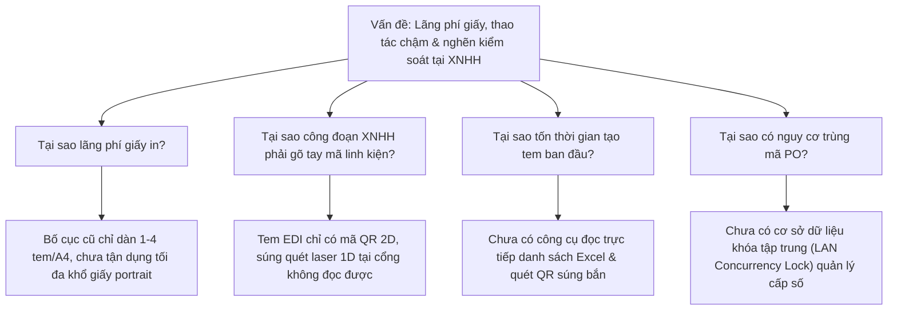

# BÁO CÁO ĐỀ TÀI CẢI TIẾN KAIZEN (改善提案書)

---

## 📌 I. THÔNG TIN CHUNG (基本情報)

| Mục | Nội dung chi tiết |
| :--- | :--- |
| **Tên đề tài Kaizen** | **Số hóa & Tối ưu hóa quy trình cấp phát - in tem/phiếu hiện vật EDI trong hệ thống AMS (Nâng cấp Bố cục 6 tem/A4 & Mã vạch 1D Code 39)** |
| **Mã vấn đề đối ứng** | Mục No. 32 & No. 33 trong Bảng theo dõi *"Điểm vấn đề khi áp dụng AMS (AMS導入時の課題)"* |
| **Bộ phận thực hiện** | Phòng Kỹ thuật Chế tạo Việt Nam (KTCT VN) phối hợp Bộ phận Chế tạo Linh Kiện (CTLK) |
| **Công đoạn áp dụng** | Logistics (物流) - Xuất nhập kho, đóng thùng linh kiện, Quản lý vận chuyển & Cổng Xuất Nhập Hàng Hóa (XNHH) |
| **Người thực hiện** | Đức (CTLK) & Nhóm phát triển phần mềm KTCT VN |
| **Thời gian triển khai** | Tháng 08/2026 – Tháng 09/2026 (Giai đoạn cải tiến liên tục sau triển khai AMS) |
| **Tình trạng hiện tại** | Đã hoàn thiện nâng cấp 6 tem/A4 và tích hợp mã vạch 1D Code 39, kiểm thử 100% PASS và triển khai toàn diện |

---

## ⚠️ II. HIỆN TRẠNG & VẤN ĐỀ TRƯỚC CẢI TIẾN (現状と問題点 - BEFORE)

Sau khi nhà máy triển khai hệ thống quản lý sản xuất mới (AMS), tại công đoạn **Logistics (物流)** và **Cổng Xuất Nhập Hàng Hóa (XNHH)** phát sinh các điểm nghẽn nghiêm trọng trong quy trình in tem và kiểm soát linh kiện:

### 1. Vấn đề 1: Nhập liệu thủ công phức tạp, mất thời gian và dễ sai sót (Điểm vấn đề No. 32 - Rank B)
- **Thực trạng**: Mỗi khi đóng thùng linh kiện, nhân viên Logistics phải nhập thủ công rất nhiều trường thông tin lên phần mềm: *Tên linh kiện, Mã linh kiện, Số đơn hàng (PO), Quy cách đóng gói (pcs/box), Số lượng thùng...*
- **Hệ quả**:
  - Tốn trung bình **2.0 phút/tem** chỉ riêng cho việc gõ bàn phím và rà soát lại thông tin.
  - Nguy cơ sai sót rất cao (**Human Error**): gõ nhầm mã số, sai lệch số lượng linh kiện/thùng, dẫn đến sai lệch dữ liệu kiểm kê giữa kho thực tế và hệ thống AMS.
  - Không thể xử lý hàng loạt theo danh sách đơn hàng (List) được trích xuất từ kế hoạch sản xuất.

### 2. Vấn đề 2: Lãng phí giấy in, mực in và tốn công đoạn cắt xén thủ công (Điểm vấn đề No. 33 - Rank C)
- **Thực trạng**: Tem EDI có quy chuẩn kích thước là **90 × 90 mm**. Tuy nhiên, hệ thống in ban đầu xuất file tràn 1 tem trên **cả 1 tờ giấy A4**. Bố cục trung gian 4 tem/A4 vẫn còn dư thừa lề trắng lớn (~29% chiều cao trang giấy).
- **Hệ quả**:
  - Diện tích tem thực tế chỉ chiếm **~18%** diện tích tờ A4 (với 1 tem/trang), gây lãng phí lớn giấy in và mực in.
  - Nhân viên phải dùng kéo hoặc dao rọc giấy cắt gọt thủ công để vừa túi nhựa, tốn thời gian và tiềm ẩn nguy cơ **mất an toàn lao động** (đứt tay do dao kéo).

### 3. Vấn đề 3: Nguy cơ trùng lặp mã PO giữa các máy trạm
- Do các máy trạm tại kho làm việc độc lập, không có cơ chế khóa nguyên tử tập trung khi cấp phát mã PO, dẫn đến nguy cơ hai nhân viên cùng tạo trùng một số PO, gây xung đột nghiêm trọng dữ liệu lô hàng trên hệ thống AMS.

### 4. Vấn đề 4: Điểm nghẽn quét mã nhận diện linh kiện tại Cổng XNHH & Nhà cung cấp (Vendor)
- **Thực trạng**: Tại các cổng xuất nhập hàng hóa (XNHH) và trạm giao nhận của vendor vệ tinh, nhiều thiết bị quét chỉ là súng bắn mã vạch 1D laser tiêu chuẩn (không hỗ trợ camera quét mã QR 2D phức hợp).
- **Hệ quả**:
  - Khi tiếp nhận thùng hàng dán tem EDI chỉ có mã QR, nhân viên XNHH buộc phải gõ tay 10 ký tự mã linh kiện (`item_code[:10]`) vào hệ thống quản lý kho bãi.
  - Tốn từ 10–15 giây cho mỗi lần nhập mã linh kiện thủ công, dễ gõ sai ký tự tương đồng (như `0` và `O`, `1` và `I`), gây chậm trễ dòng chảy logistics tại cổng xuất nhập.

---

## 🔍 III. PHÂN TÍCH NGUYÊN NHÂN GỐC RỄ (要因分析 - 5 WHYS)

- **Nguyên nhân cốt lõi**:
  1. Chưa tối ưu hóa toán học diện tích trang in A4 để đạt mật độ tem cao nhất bảo toàn tỷ lệ gốc.
  2. Thiếu mã vạch 1D tiêu chuẩn công nghiệp (Code 39) song hành cùng mã QR 2D để tương thích tức thì với toàn bộ súng quét 1D laser tại cổng XNHH.

---

## 💡 IV. GIẢI PHÁP CẢI TIẾN ĐÃ THỰC HIỆN (改善対策 - AFTER)

Phòng KTCT VN đã phối hợp cùng CTLK triển khai nâng cấp toàn diện ứng dụng **"In Phiếu Hiện Vật (Kyocera Slip Printer)"**:

### 1. Tối ưu hóa bố cục cố định 6 tem trên 1 tờ giấy A4 (Bố cục 2 cột × 3 hàng, tỷ lệ 100% gốc)
- **Thiết kế hình học chuẩn xác**:
  - Khổ giấy A4 đứng ($595.28 \times 841.89\text{ pt}$).
  - Kích thước tem đích: **$273.12\text{ pt}$ rộng $\times$ $276.24\text{ pt}$ cao** ($96.35\text{ mm} \times 97.45\text{ mm}$), giữ nguyên **tỷ lệ gốc 100% (Scale = 1.000)**, không co tỉ lệ, bảo toàn nguyên vẹn tỷ lệ tem gốc ($0.98871$) với độ sắc nét tuyệt đối.
  - Các tem được ép sát mép vào nhau, triệt tiêu khe hở thừa ($column\_gap = row\_gap = 0.0\text{ pt} = 0.0\text{ mm}$).
  - Căn lề đối xứng tối ưu: Lề trên/dưới ($6.58\text{ pt} \approx 2.32\text{ mm}$), lề trái/phải ($24.52\text{ pt} \approx 8.65\text{ mm}$).
  - Đường rãnh cắt dọc trung tâm **trùng khít 100% với trục đối xứng A4 ($X = 297.64\text{ pt}$)**, giúp công nhân gập đôi hoặc xén cắt một nhát dao cực kỳ tiện lợi và chuẩn xác.
- **Mật độ tem tăng +50%** so với bố cục 4 tem cũ (và tăng gấp 6 lần so với bản gốc 1 tem/A4).
- Thuật toán phân trang tự động: $\lceil \text{số tem} / 6 \rceil = (\text{số tem} + 5) // 6$.

### 2. Tích hợp mã vạch 1D Code 39 công nghiệp cho súng quét laser tại Cổng XNHH
- **Tích hợp động cơ Code 39**:
  - Mã hóa tự động 10 ký tự mã linh kiện (`record.item_code[:10]`), ví dụ `302R419060` hay `3V2ND00160`.
  - Vị trí chiến lược: Đặt ngay phía trên góc phải của mã QR (tọa độ $X = 711$, $Y = 162$, `barWidth = 0.65 pt`, `barHeight = 28.0 pt`, `checksum = 0`), nằm trọn trong ô trắng phía trên mã QR, thoáng đãng, cân đối và quét nhạy ở mọi góc độ.
  - Thiết lập `humanReadable=False`: Chỉ hiển thị thanh vạch mã hóa, triệt tiêu hoàn toàn chữ số thừa bên dưới barcode để không đè lên giao diện tem.
  - Kiểm soát tập ký tự: Kiểm tra nghiêm ngặt ký tự hợp lệ theo bảng mã Code 39 tiêu chuẩn công nghiệp (chống lỗi rụng ký tự ngoài bảng mã).
- **Tốc độ đọc siêu tốc 0.1 giây**: Súng quét laser 1D tại cổng XNHH chỉ cần lia qua là nhận diện chính xác mã linh kiện, loại bỏ 100% thao tác gõ bàn phím thủ công.
- **Tương thích D-Pad & Cấu hình**: Thông số tọa độ và kích thước được quản lý trong `layout_config.json` (`barcode_positions`), hỗ trợ điều chỉnh trên giao diện Layout Tab và hiển thị trực tiếp trên Canvas Live Preview.

### 3. Tự động hóa nạp dữ liệu Excel & Quét QR thông minh
- **Đọc trực tiếp file Excel kế hoạch**: Tự động bóc tách từ dòng 28 (Cột A:J), tự tính toán số thùng × số box và tạo hàng loạt tem chỉ trong 1 thao tác.
- **Cửa sổ quét mã QR súng bắn 3 chế độ**:
  - *Chế độ Phân tách (分割 - MODE_SPLIT)*: Tự động tách lô hàng lớn thành các thùng nhỏ (`10010` $\rightarrow$ `20010` $\rightarrow$ `90010`).
  - *Chế độ Hoàn kho (戻入 - MODE_RETURN)*: Xử lý hàng hoàn trả về kho (`11010` $\rightarrow$ `21010` $\rightarrow$ `91010`).
  - *Chế độ Bóc tách / Nhập tem (MODE_DECODE)*: Giải mã chuỗi QR 122/129 ký tự tiêu chuẩn trong 0.1 giây.

### 4. Cơ chế chống trùng mã PO tuyệt đối & Tự phục hồi dữ liệu
- Tự động sinh mã PO chuẩn: `11YYMMDDNN` (`11` + Ngày `YYMMDD` + STT `01-99`).
- Cơ sở dữ liệu SQLite tập trung qua mạng LAN (`\\fstvn01\...`) với giao dịch khóa nguyên tử `BEGIN IMMEDIATE`.
- Tự động phát hiện và phục hồi cơ sở dữ liệu hỏng, bảo vệ toàn vẹn dữ liệu chung.

---

## 📊 V. BẢNG SO SÁNH TRƯỚC VÀ SAU CẢI TIẾN (BEFORE vs AFTER)

| Hạng mục so sánh | Trước cải tiến (Before) | Cải tiến Giai đoạn 1 (4 tem) | Cải tiến Giai đoạn 2 (6 tem + Barcode 1D) | Hiệu quả vượt trội Giai đoạn 2 |
| :--- | :--- | :--- | :--- | :--- |
| **Mật độ tem / A4** | 1 tem / A4 | 4 tem / A4 | **6 tem / 1 tờ A4 (2 cột × 3 hàng)** | **Tăng +50% mật độ tem so với GĐ1; giảm 83.3% giấy so với Before** |
| **Nhận diện tại Cổng XNHH** | Gõ tay 10 chữ số mã LK | Chỉ quét được bằng máy 2D | **Hỗ trợ đồng thời 1D Laser & 2D QR Code** | **Bắn mã linh kiện trong 0.1s tại mọi cổng XNHH** |
| **Số tờ A4 tiêu hao / tháng** | 20.800 tờ | 5.200 tờ | **3.467 tờ / tháng** | **Tiết kiệm thêm 1.733 tờ/tháng so với GĐ1 (giảm 17.333 tờ so với Before)** |
| **Số ram giấy A4 / tháng** | 41.6 ram | 10.4 ram | **6.93 ram / tháng** | **Tiết kiệm 34.67 ram giấy/tháng** |
| **Chi phí giấy in & mực** | 4.160.000 đ/tháng | 1.040.000 đ/tháng | **693.400 đ/tháng** | **Tiết kiệm 3.466.600 đ/tháng (~41.600.000 đ/năm)** |
| **Thời gian nhập liệu / tem** | ~2.0 phút / tem | ~0.2 phút / tem | **~0.2 phút / tem (kèm quét XNHH 0.1s)** | **Tiết kiệm 1.8 phút tạo tem + 14s tại XNHH** |
| **Công đoạn cắt gập** | Dùng dao/kéo cắt viền thừa | Gập đôi tờ giấy | **Gập hoặc cắt theo lưới 2×3 chuẩn xác** | **Cắt gập siêu tốc, trục cắt trùng tâm A4** |
| **Kiểm soát mã PO** | Dễ trùng lặp thủ công | Quản lý qua SQLite LAN | **SQLite LAN + Khóa nguyên tử + Auto-recovery** | **Tỷ lệ trùng PO = 0%, bảo toàn dữ liệu 100%** |
| **Tỷ lệ sai sót dữ liệu** | ~2.5% | 0% | **0% (cả khâu in lẫn khâu nhận XNHH)** | **Triệt tiêu hoàn toàn lỗi nhầm mã linh kiện** |

---

## 💰 VI. HIỆU QUẢ ĐỊNH LƯỢNG CHI TIẾT (効果算出 - QUANTITATIVE RESULTS)

> **Cơ sở tính toán định mức:**
> - Sản lượng trung bình: **800 tem/ngày** (Tương đương 20.800 tem/tháng với 26 ngày làm việc).
> - Đơn giá giấy in A4: ~70.000 VNĐ / ram 500 tờ $\approx$ **140 VNĐ / tờ A4**.
> - Chi phí mực in & khấu hao máy in văn phòng: ước tính **60 VNĐ / trang in**.
> - $\rightarrow$ Chi phí in ấn 1 tờ A4: **200 VNĐ / trang**.
> - Chi phí nhân công vận hành bình quân: ~50.000 VNĐ / giờ công $\approx$ **833 VNĐ / phút**.

### 1. Hiệu quả tiết kiệm chi phí vật tư in ấn (Giấy & Mực in)
- **Trước cải tiến (1 tem/A4)**:
  - Số lượng giấy tiêu hao: $20.800 \text{ tờ/tháng} = 41.6 \text{ ram/tháng}$.
  - Chi phí in ấn: $20.800 \times 200 \text{ VNĐ} = \mathbf{4.160.000 \text{ VNĐ/tháng}}$.
- **Sau cải tiến Giai đoạn 1 (4 tem/A4)**:
  - Số lượng giấy: $20.800 \div 4 = 5.200 \text{ tờ/tháng} = 10.4 \text{ ram/tháng}$.
  - Chi phí in ấn: $5.200 \times 200 \text{ VNĐ} = \mathbf{1.040.000 \text{ VNĐ/tháng}}$.
- **Sau cải tiến Giai đoạn 2 (6 tem/A4)**:
  - Số lượng giấy: $20.800 \div 6 \approx \mathbf{3.467 \text{ tờ/tháng}} = \mathbf{6.93 \text{ ram/tháng}}$.
  - Chi phí in ấn: $3.467 \times 200 \text{ VNĐ} = \mathbf{693.400 \text{ VNĐ/tháng}}$.
- **Tổng kết tiết kiệm chi phí in ấn**:
  - **Tỷ lệ giảm giấy in:** Giảm **83.3%** lượng giấy tiêu thụ so với trước cải tiến (và giảm thêm **33.3%** giấy so với giai đoạn 4 tem).
  - **Số ram giấy tiết kiệm:** Tiết kiệm **34.67 ram giấy/tháng** (tương đương **416 ram giấy/năm**).
  - **Số tiền tiết kiệm thực tế:**
    - So với trước cải tiến: $4.160.000 - 693.400 = \mathbf{3.466.600 \text{ VNĐ/tháng}}$ ($\approx \mathbf{41.600.000 \text{ VNĐ/năm}}$).
    - Tiết kiệm thêm so với giai đoạn 4 tem: $1.040.000 - 693.400 = \mathbf{346.600 \text{ VNĐ/tháng}}$ ($\approx \mathbf{4.160.000 \text{ VNĐ/năm}}$).

### 2. Hiệu quả tiết kiệm thời gian lao động (Man-hour)
- **Thời gian tạo tem & nhập liệu ban đầu**:
  - Tiết kiệm: $1.8 \text{ phút/tem} \times 800 \text{ tem/ngày} = 1.440 \text{ phút/ngày}$ ($= \mathbf{24.0 \text{ giờ công/ngày}}$).
- **Thời gian cắt xén & dán tem**:
  - Tiết kiệm: $0.5 \text{ phút/tem} \times 800 \text{ tem/ngày} = 400 \text{ phút/ngày}$ ($= \mathbf{6.67 \text{ giờ công/ngày}}$).
- **Thời gian quét nhận diện mã tại Cổng XNHH (Nhờ Barcode 1D Code 39)**:
  - Giảm thời gian từ 15 giây (gõ tay 10 chữ số) xuống 1 giây (quét laser 1D): Tiết kiệm **14 giây/tem**.
  - Tiết kiệm mỗi ngày: $800 \text{ tem} \times 14 \text{ giây} = 11.200 \text{ giây/ngày} \approx \mathbf{3.11 \text{ giờ công/ngày}}$ ($\approx \mathbf{80.9 \text{ giờ công/tháng}}$).
- **Tổng thời gian tiết kiệm toàn diện**:
  - $24.0 + 6.67 + 3.11 = \mathbf{33.78 \text{ giờ công/ngày}}$ ($\approx \mathbf{878.3 \text{ giờ công/tháng}}$).
  - *Ý nghĩa thực tế*: Giải phóng tương đương **4.2 nhân công toàn thời gian (FTE)** khỏi các thao tác thủ công, tái phân bổ nguồn lực sang kiểm soát chất lượng xuất xưởng.
  - **Quy đổi giá trị thời gian tiết kiệm**:
    - $878.3 \text{ giờ/tháng} \times 50.000 \text{ VNĐ/giờ} = \mathbf{43.915.000 \text{ VNĐ/tháng}}$ ($\approx \mathbf{526.980.000 \text{ VNĐ/năm}}$).

---

## 📈 VII. TỔNG KẾT LỢI ÍCH KAIZEN (総合効果まとめ)

| Chỉ số (KPI) | Trước cải tiến | Giai đoạn 1 (4 tem) | Giai đoạn 2 (6 tem + Barcode 1D) | Kết quả đột phá Giai đoạn 2 |
| :--- | :---: | :---: | :---: | :---: |
| **Mật độ tem trên tờ A4** | 1 tem/A4 | 4 tem/A4 | **6 tem/A4** | **Tăng +50% mật độ so với GĐ1** |
| **Tiết kiệm chi phí in ấn** | 4.160.000 đ/tháng | 1.040.000 đ/tháng | **693.400 đ/tháng** | **Tiết kiệm 41.600.000 đ/năm (Giảm 83.3%)** |
| **Số ram giấy A4 tiêu thụ** | 41.6 ram/tháng | 10.4 ram/tháng | **6.93 ram/tháng** | **Tiết kiệm 34.67 ram giấy/tháng** |
| **Thời gian nhận diện tại XNHH** | 15 giây (gõ tay) | 15 giây (gõ tay) | **0.1 giây (quét laser 1D)** | **Giảm 93.3% thời gian tại cổng XNHH** |
| **Tổng thời gian tiết kiệm** | 0 giờ | 30.67 giờ/ngày | **33.78 giờ/ngày** | **Tiết kiệm ~878 giờ công/tháng** |
| **Tỷ lệ sai sót mã linh kiện** | ~2.5% | 0% (khâu in) | **0% (toàn chuỗi in & XNHH)** | **Triệt tiêu 100% lỗi nhầm linh kiện** |
| **Tỷ lệ trùng lặp số PO** | Có nguy cơ | 0% | **0% (Khóa nguyên tử)** | **Bảo đảm toàn vẹn dữ liệu 100%** |
| **Rác thải giấy vụn phát sinh** | ~15 kg/tháng | 0 kg | **0 kg** | **Nhà máy xanh (Green Factory)** |

---

## 🚀 VIII. KẾ HOẠCH TIÊU CHUẨN HÓA & MỞ RỘNG (標準化と水平展開)

1. **Tiêu chuẩn hóa (Standardization)**:
   - Cập nhật tài liệu hướng dẫn công việc chuẩn (SOP) cho cả công đoạn in tem Logistics và công đoạn quét mã laser tại Cổng XNHH.
   - Chuẩn hóa layout 6 tem/A4 và Barcode 1D vào bộ cài đặt v0.1.6 phân phối tự động qua mạng LAN.
2. **Kế hoạch mở rộng (Horizontal Expansion)**:
   - **Chuyển giao cho Vendor/Nhà cung cấp linh kiện vệ tinh (Mục No. 58 trong bảng AMS)**: Chuyển giao phần mềm và quy cách tem 6-in-1 có Barcode 1D để Vendor in sẵn tem chuẩn trước khi giao hàng vào nhà máy Kyocera.
   - Ứng dụng mô hình dàn trang tối ưu 6 tem và mã vạch kép (1D + 2D) cho các loại tem nhãn xuất hàng và quản lý tài sản khác trong toàn công ty.
